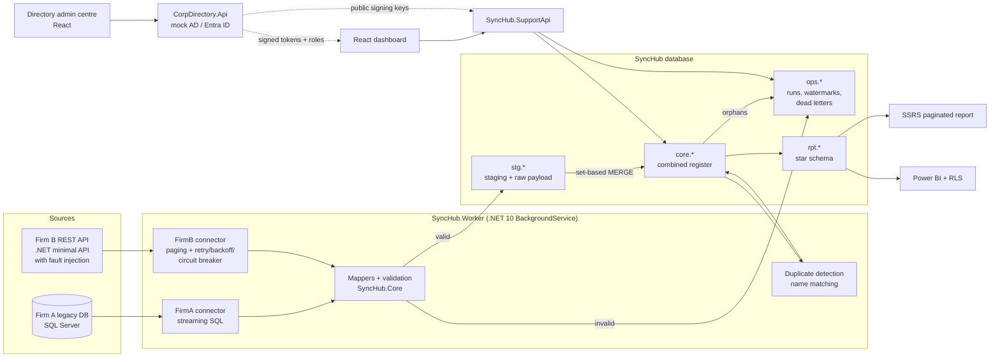

# Merger Sync Hub

[](https://github.com/michaeljohnkearney83/MergerSyncHub/actions/workflows/ci.yml)


A working model of a problem every merged law firm faces: **two practice management systems, one firm.**

- **Firm A** is a legacy UK system: an older SQL Server database with messy data, local timestamps and no foreign keys.
- **Firm B** is a US system exposed as a REST API that pages its data and sometimes fails or times out.

The **Sync Hub** pulls clients and matters from both and validates and standardises them. It merges them into
one register, flags clients that look like duplicates (within a firm or across both firms) and reports
on the result in **SSRS** and **Power BI**. A **React support dashboard** lets a third-line analyst see
failures, correct bad records, replay them, review duplicates and fix mappings, without anyone touching the database.

> Built as a personal project to explore the integration challenges of a law-firm merger.
> All data is synthetic.

### Contents

| Understand it | Run it | Go deeper |
|---|---|---|
| [Key terms](#key-terms) | [Prerequisites](#prerequisites) | [Monitoring](#6-monitoring-optional-prometheus-loki-and-grafana) |
| [Versions](#versions) | [Create the databases](#1-create-the-databases) | [Git hooks](#5-git-hooks-for-feature-branches-optional) |
| [Architecture](#architecture) | [Run the tests](#2-run-the-tests) | [Design decisions](#design-decisions-the-why) |
| [What's in the repo](#whats-in-the-repo) | [Start everything (Docker or by hand)](#3-start-everything) | [Data lifetimes](#data-lifetimes) · [Known limitations](#known-limitations-and-what-id-do-next) |
| [Full glossary](docs/glossary.md) · [Azure design](docs/azure-architecture.md) · [Azure lab](docs/azure-lab.md) | [Sign in (demo accounts)](#4-sign-in) | [Interview guide](docs/interview-guide.md) |
| | [10-minute demo](#a-10-minute-demo) | |

### Key terms

| Term | In one line |
|---|---|
| **Client** | Who the firm acts for, e.g. "Acme Holdings Ltd". |
| **Matter** | One piece of legal work for a client (a case, a deal). Firms bill and check conflicts per matter. |
| **Sync run** | One pass that reads a source's changes and merges them into the hub. |
| **Dead letter / exception** | A record that failed validation, parked with its data and the reason, so the rest carries on. Support sees these on the **Exceptions** tab. |
| **Replay** | Re-processing a dead letter, usually after correcting it, through the same rules as live data. |
| **Reconciliation** | Proving nothing was lost: source total = in hub + open exceptions + ignored. |
| **Duplicate candidate** | Two client records that are probably the same organisation; a data steward confirms or rejects. |

More terms (watermark, look-back, staging, idempotent, orphan matter, roles...) are in the **[glossary](docs/glossary.md)**.

### Versions

| Area | Technology | Version |
|---|---|---|
| Runtime | .NET (all four services target `net10.0`), C# `latest` | 10 |
| Web APIs | ASP.NET Core minimal APIs, JWT bearer auth | 10.0 |
| Data access | Dapper / Microsoft.Data.SqlClient | 2.1.35 / 5.2.2 |
| Resilience | Microsoft.Extensions.Http.Resilience (Polly) | 8.10 |
| Database | SQL Server (Docker image `mssql/server:2022-latest`) | 2022 |
| Front end | React / TypeScript / Vite | 18.3 / 5.6 / 5.4 |
| Telemetry (services) | OpenTelemetry .NET SDK, OTLP exporter | 1.21.0 |
| Telemetry (browser) | Grafana Faro Web SDK | 2.15 |
| Azure | Bicep (infrastructure as code) / Azure Monitor OpenTelemetry Exporter | 0.48 / 1.10.0 |
| Monitoring | OpenTelemetry Collector (contrib) / Prometheus / Loki / Grafana / Alloy | 0.130.0 / 3.5.0 / 3.5.0 / 12.1.0 / 1.22.0 |
| Tests | xUnit / Testcontainers.MsSql / Mvc.Testing | 2.9 / 4.17.0 / 10.0.15 |
| Containers | Build images: .NET SDK 10.0, Node 22 (alpine); runtime: ASP.NET Core 10.0, nginx 1.27 | |
| Reporting | Power BI Desktop (PBIP project, TMDL), SSRS | model in `reports/powerbi/`; SSRS guide in `reports/ssrs/` |

Exact package versions live in each `.csproj` and `package.json`; image tags in `docker-compose.yml` and `docker/`.

---

## Architecture



**One sync cycle (every 60 seconds by default):**

1. **Replay** anything queued from the dashboard.
2. For each source: **read changes since the watermark → map and validate → bulk stage → MERGE → move the watermark**.
3. **Detect** possible duplicate clients.
4. **Refresh** the reporting star schema (every 5 minutes by default).

<sub>[↑ Back to top](#merger-sync-hub)</sub>

## What's in the repo

The .NET projects are grouped by role, both on disk and in `src/MergerSyncHub.sln`:

```
src/
├── Libraries/   SyncHub.Core, SyncHub.Observability       shared code, no hosting
├── Services/    SyncHub.Worker, SyncHub.SupportApi        the real system
└── Mocks/       CorpDirectory.Api, FirmB.MockApi          stand-ins for Entra ID and the other firm's system
tests/           SyncHub.Tests, SyncHub.IntegrationTests
```

| Path | What it is |
|---|---|
| `database/` | SQL scripts: both databases, schemas, stored procedures, reporting layer, read-only reporting login, plus `setup.ps1` |
| `database/perf/` | Before-and-after indexing demo on the legacy extract query |
| `database/demo/` | Script that simulates users editing records in Firm A |
| `src/Libraries/SyncHub.Core` | Pure logic: models, mappers, validation, name normalisation, duplicate matching |
| `src/Services/SyncHub.Worker` | The integration engine (.NET 10 worker service) |
| `src/Services/SyncHub.SupportApi` | Minimal API behind the dashboard |
| `src/Mocks/FirmB.MockApi` | The "other firm's" API, with random outages, slow responses and bad records |
| `src/Mocks/CorpDirectory.Api` | Mock corporate directory (stands in for Active Directory / Entra ID): sign-in, roles, joiners and leavers |
| `directory-admin/` | React admin centre for the directory: add new starters, manage access, disable leavers, audit log |
| `src/Libraries/SyncHub.Observability` | Shared OpenTelemetry set-up: every service sends metrics and logs to the collector |
| `tests/SyncHub.Tests` | xUnit unit tests for mapping, validation, time zones and matching |
| `tests/SyncHub.IntegrationTests` | Security and database tests against the real API and stored procedures (needs Docker) |
| `dashboard/` | React + TypeScript (Vite) support dashboard |
| `reports/ssrs/` | Step-by-step build of the SSRS exceptions report |
| `reports/powerbi/` | Power BI project (`MergerSyncHub.pbip`): star schema model, 17 measures and row-level security, stored as text (TMDL) |
| `infra/` | Bicep templates for Azure: Container Apps, Azure SQL (Entra-only), Key Vault, Container Registry, Application Insights, budget ([design](docs/azure-architecture.md)) |
| `docker/` | Shared Dockerfiles for the .NET services and React apps, nginx config, and the one-off database setup script |
| `monitoring/` | OpenTelemetry Collector, Prometheus (with alert rules), Loki and Grafana (provisioned dashboard) config |
| `docs/interview-guide.md` | How this project maps to the interview questions |
| `.claude/agents/sql-reviewer.md` | Claude Code subagent that reviews the SQL scripts and repository queries (ask Claude to "use the sql-reviewer agent") |
| `.claude/agents/observability-advisor.md` | Claude Code subagent that suggests where to add logs, metrics, alerts and dashboard panels |
| `.claude/agents/coding-standards.md` | Claude Code subagent that checks a diff against the project's coding standards (PASS / FAIL) |
| `.githooks/pre-push` | Runs the coding-standards agent before any push to a `feature/*` branch |
| `.githooks/post-commit` | Merges the latest `main` into a `feature/*` branch after each commit |

<sub>[↑ Back to top](#merger-sync-hub)</sub>

---

## Getting started

### Prerequisites

- .NET 10 SDK
- Node.js 20+
- SQL Server 2019+ (local install, or Docker using the included compose file: see step 1)
- `sqlcmd` (installed with SSMS or the SQL Server command-line tools)
- Optional: Power BI Desktop, Power BI Report Builder / SSRS

### 1. Create the databases

**Using Docker?** Start SQL Server first. Copy `.env.example` to `.env` (Git ignores it), set your own
`sa` password, then:

```powershell
docker compose up -d
```

Then create the databases:

```powershell
cd database
.\setup.ps1                                   # local SQL Server, Windows auth
# .\setup.ps1 -Server "localhost\SQLEXPRESS"  # named instance
# .\setup.ps1 -Server "localhost,14333" -User sa -Password '<your sa password>'   # Docker
```

Or open scripts 01–06 in SSMS and run them in order. Firm A ends up with about 375 clients and 75,000 matters.
(07, the reporting login, needs its password as a sqlcmd variable, so run it through `setup.ps1` or as shown in the script's header.)

**For Power BI and SSRS**, `setup.ps1` also creates a read-only reporting login, `synchub_reporting`, when it's given a
password: set `REPORTING_SQL_PASSWORD` (in `.env` for Docker, where `db-init` applies it on every start) or pass
`-ReportingPassword`. The login can read only the `rpt` reporting schema. See [the Power BI guide](reports/powerbi/README.md).

**Using Docker or SQL authentication?** Store your connection strings as .NET user secrets (outside the project,
so no password is ever committed):

```powershell
.\set-local-secrets.ps1 -Password '<your sa password>'
```

The committed `appsettings.json` files contain only password-free defaults (Windows authentication).

### 2. Run the tests

```powershell
dotnet test src                       # everything (the integration tests need Docker running)
dotnet test tests/SyncHub.Tests       # unit tests only: fast, no Docker
```

| Project | What it proves | Needs |
|---|---|---|
| `SyncHub.Tests` | Mapping and validation, UK time conversion, name normalisation, duplicate matching | Nothing |
| `SyncHub.IntegrationTests` | **Security:** invalid tokens are rejected (expired, wrong issuer, wrong audience, wrong key); each role can do only what it should; the audit trail records the user from the token, never from the request body. **Database:** merges are idempotent; a stale replay can't overwrite newer data; a scheduled read wins across the October clock change; reconciliation counts an ignored-then-failed record once. | Docker |

The integration tests start a throwaway SQL Server container (Testcontainers) with the real schema and stored
procedures, and host the real Support API in memory (`WebApplicationFactory`). Only the token signing key is
swapped for a test key, so every other part of token validation runs exactly as in production. The first run
takes about 20 seconds while SQL Server starts.

**Continuous integration** ([`.github/workflows/ci.yml`](.github/workflows/ci.yml)) runs on every push to `main` or a
`feature/*` branch and on pull requests. It has four parallel jobs: the .NET build (warnings are errors) and unit tests;
the integration tests (GitHub's Linux runners have Docker); a type-check and build of both React apps; and lint for the
Bicep templates and the PowerShell scripts (PSScriptAnalyzer, rules in `PSScriptAnalyzerSettings.psd1`). It needs no
secrets and never signs in to Azure. To lint the scripts locally:

```powershell
Get-ChildItem -Recurse -Filter *.ps1 | ForEach-Object { Invoke-ScriptAnalyzer -Path $_.FullName -Settings .\PSScriptAnalyzerSettings.psd1 }
```

### 3. Start everything

**Option A: all in Docker (one command).** Needs only Docker and a `.env` file (copy `.env.example`):

```powershell
docker compose --profile app --profile monitoring up -d --build
```

- Builds and starts the four .NET services and both React apps on the same ports as below, plus SQL Server
  and the monitoring stack. The first build takes a few minutes; later ones reuse cached layers.
- A one-off `db-init` container runs the database scripts the first time only (when the databases don't
  exist yet), so restarting the stack never wipes your data.
- The directory's token signing key lives on a Docker volume, so restarts don't sign everyone out.
- After changing code, rebuild just what changed, e.g. `docker compose --profile app up -d --build sync-worker`.
- Stop with `docker compose --profile app --profile monitoring down` (add `-v` only if you want to delete the data).

| Docker service | Project | Port |
|---|---|---|
| `directory-api` | `src/Mocks/CorpDirectory.Api` (mock corporate directory) | 5090 |
| `directory-web` | `directory-admin/` (directory admin centre) | 5174 |
| `support-api` | `src/Services/SyncHub.SupportApi` | 5081 |
| `support-web` | `dashboard/` (support dashboard) | 5173 |
| `firmb-api` | `src/Mocks/FirmB.MockApi` | 5070 |
| `sync-worker` | `src/Services/SyncHub.Worker` | (none) |
| `db-init` | `database/` scripts, runs once and exits | (none) |

Names follow `<area>-<kind>` so each API sits next to its web front end; containers are `synchub-<service>`.

Inside Docker the Support API reaches the directory as `http://directory-api:8080`, but tokens are issued as
`http://localhost:5090` (the address the browser uses). So the Support API is given both: `Auth:Authority` (the
issuer it trusts) and `Auth:MetadataAddress` (where it can actually download the keys). The directory's discovery
document builds its key URL from the address it was called on, so that works whichever name is used.

**Option B: run each project yourself (best for development).** Faster to edit and re-run. Stop the
containers first if they're running, because they use the same ports. Six terminals:

Start the directory first: the Support API downloads its signing keys from it.

```powershell
dotnet run --project src/Mocks/CorpDirectory.Api       # http://localhost:5090  (seeds demo accounts on first run)
dotnet run --project src/Mocks/FirmB.MockApi           # http://localhost:5070
dotnet run --project src/Services/SyncHub.Worker       # starts syncing immediately
dotnet run --project src/Services/SyncHub.SupportApi   # http://localhost:5081/swagger
cd dashboard; npm install; npm run dev        # http://localhost:5173  (SyncHub dashboard)
cd directory-admin; npm install; npm run dev  # http://localhost:5174  (Directory admin centre)
```

### 4. Sign in

Demo accounts are created on the directory's first start. They all use the password **`Welcome2SyncHub!`**.
You can sign in with just the part before the `@`.

| Username | Role | Can do |
|---|---|---|
| `it.admin` | Directory admin + SyncHub admin | Everything in both apps |
| `alex.morgan` | SyncHub Support Analyst | Fix, replay and ignore exceptions |
| `priya.shah` | SyncHub Data Steward | Decide duplicates, map practice areas |
| `tom.reid` | SyncHub Viewer | Read-only |
| `jordan.lee` | (no groups) | Gets "not given access to this application" |
| `sam.carter` | Viewer, **disabled** (a leaver) | Gets "account disabled" |

Access works as in Entra ID: users are put in **security groups**, each group grants one **app role**, and the
sign-in token for an app carries only that app's roles. The Support API checks the token's signature
against the directory's published keys and enforces the roles. Five wrong passwords lock an account for 5 minutes.

The first cycle does a full load (75k Firm A matters take a few seconds with SqlBulkCopy). Later cycles
are incremental. In the worker console you'll see Firm B's injected 503s and timeouts being retried
(`Polly` warnings) without the run failing.

### 5. Git hooks for feature branches (optional)

Two Git hooks live in `.githooks/`. Hooks aren't copied by `git clone`, so turn them on once per clone:

```powershell
git config core.hooksPath .githooks
```

**post-commit: keep feature branches up to date with main.** After each commit on a `feature/*` branch it
fetches `origin/main` (or uses the local `main` if there's no remote) and merges it in, so conflicts show up
while the change is small.

- Nothing happens if `main` has no new commits, or during a rebase, cherry-pick or merge.
- On a conflict it aborts the merge and lists the clashing files; your commit is untouched. Run
  `git merge origin/main` when you're ready to resolve.
- Skip it once with `SKIP_AUTO_MERGE=1 git commit ...`. `AUTO_MERGE_BASE` changes the source branch.

**pre-push: coding standards.** Runs the `coding-standards` Claude agent over the commits you are pushing to
any `feature/*` branch. It needs the `claude` CLI on your PATH.

- Blocking findings (for example SQL built from input, a secret, a non-re-runnable script, a run/config change
  without a README update) stop the push; advisory ones are printed and the push continues.
- Skip it once with `git push --no-verify`.
- If the `claude` CLI is missing or fails, the push goes ahead with a warning. Set `STANDARDS_FAIL_CLOSED=1` to
  block instead. `STANDARDS_BRANCHES` changes which branches are checked (default `feature/*`).
- The rules live in `.claude/agents/coding-standards.md`; edit that file to change them.

### 6. Monitoring (optional): Prometheus, Loki and Grafana

```powershell
docker compose --profile monitoring up -d
```

| What | Where |
|---|---|
| Grafana, with the **Merger Sync Hub** dashboard as the home page | http://localhost:3033 (anonymous view; `admin` / `admin` to edit) |
| Prometheus, including the alerts in `monitoring/alert-rules.yml` | http://localhost:9090/alerts |
| Loki (queried through Grafana's Explore page) | http://localhost:3100 |
| OpenTelemetry Collector (OTLP in) | `localhost:14317` gRPC, `localhost:14318` HTTP |
| Grafana Alloy (browser telemetry in, Faro) | `http://localhost:12347/collect` |

How it fits together:

```
.NET services --OTLP--> OpenTelemetry Collector --+--> Prometheus (metrics) --+--> Grafana
                                                  +--> Loki (logs) ----------+
```

- Every service calls `builder.AddObservability(...)` from `src/Libraries/SyncHub.Observability`. It collects the
  platform's built-in meters (HTTP server and client, runtime, Polly) and the worker's business metrics
  (`SyncMetrics`: records read, merged and rejected, run outcomes and durations, time since last success).
- The worker also reads state that only lives in SQL every 2 minutes (`Sync:HealthSnapshotMinutes`) and
  publishes it as gauges: open dead letters by error type and age, the reconciliation's unexplained count, and
  runs stuck at "Running". Replay runs have their own counters, so you can see whether queued fixes went through.
- Alerts (`monitoring/alert-rules.yml`): `SyncStale`, `SyncWorkerMissing`, `SyncRunsFailing`, `SyncRunStuck`,
  `CycleStepFailing`, `HighRejectionRate`, `ReconciliationInvestigate`, `DeadLettersAgeing`.
- **Browser telemetry (Grafana Faro).** Both React apps report what the server can't see: JavaScript errors,
  API calls that never reached the server (down, wrong URL, CORS), API 5xx responses, and web vitals. They go to
  Grafana Alloy and on to Loki as `service_name` `support-web` / `directory-web`, shown in the dashboard's
  "Browser" row. It's switched on by `VITE_FARO_URL` at build time (set in compose and in `.env.example`; leave
  it empty to turn it off). Privacy: no user identity is attached, only console warnings and errors are captured,
  query strings are stripped, and resource timing is off because it would include client-search URLs.
- The dashboard JSON is generated by `monitoring/grafana/make_dashboard.py`; edit panels there and re-run it.
- Logs still go to the console, and also to Loki with their scopes, so you can filter on `Source` or paste a
  run's `CorrelationId` into the dashboard to see that run's log lines.
- Services only know the collector's address (`OpenTelemetry:OtlpEndpoint` in `appsettings.json`). Leave it
  empty to switch telemetry off. If the collector isn't running, the services carry on as normal.
- Ports are offset (3033, 14317/14318) because 3000 and 4317/4318 are commonly used by other local stacks.

<sub>[↑ Back to top](#merger-sync-hub)</sub>

---

## A 10-minute demo

0. **Joiner.** Sign in to the **Directory admin centre** as `it.admin` and add yourself as a new starter
   in the *SyncHub Support Analysts* group. Note the one-time password. Sign in to the dashboard as the new
   user: you're made to choose a new password, and then you see only what a Support Analyst can do.
   Sign in as `tom.reid` to show the read-only view.
1. **Overview tab.** Tiles show what's in the hub. The **Reconciliation** table proves that
   *source total = in hub + open exceptions + ignored* for every source and entity.
2. **Show resilience.** Point at the worker log: injected 503s and slow responses are retried with
   exponential backoff and jitter. The run still succeeds.
3. **Exceptions tab.** Exceptions are grouped by type (impossible dates, close-before-open, orphan matters, missing names).
   - Open the Firm A **MissingClientName** item (client `ALDR001`). Its two matters are also failing as
     **OrphanMatter**, waiting for it.
   - Add a `"clientName"` to the payload, then click **Save and replay**.
   - On the next cycle the client is merged, **its orphan matters are queued for replay automatically**,
     and the cycle after that resolves them. Every step is recorded in the item's history.
4. **Duplicate clients tab.** Review the 13 suggested pairs, for example *ACME HOLDINGS LTD* (Firm A) and
   *ACME Holdings Corp* (Firm B). Confirm a few. After the next reporting refresh, Power BI's **Unique Clients**
   and **Shared Clients** measures reflect your decisions.
5. **Mappings tab.** Firm A's `MISC` and Firm B's `LABOR_EMPLOYMENT` codes don't map to a practice area.
   Map `LABOR_EMPLOYMENT` to `Employment`. The "Unmapped" bar in Power BI shrinks on the next refresh,
   with no re-sync needed.
6. **Incremental sync.** Run `database/demo/simulate_firmA_changes.sql`. The next Firm A run reads only
   the changed rows, and the new "keyed in wrong" matter appears as an exception.
7. **Performance.** Run `database/perf/firmA_incremental_extract.sql` with the actual execution plan on:
   a clustered index scan becomes an index seek.
8. **Reporting.** Show the SSRS exceptions report and the Power BI overview, including **View as** a
   UK-only user for row-level security.

<sub>[↑ Back to top](#merger-sync-hub)</sub>

---

## Design decisions (the "why")

| Decision | Why |
|---|---|
| **Staging table, then a set-based `MERGE`** | One round trip per batch instead of row-by-row. SqlBulkCopy is much faster than individual inserts. The staged rows are kept as an audit trail. |
| **Idempotent merge (row hash) and a watermark that moves only after commit** | If anything fails halfway, the next run re-reads the same records, and re-applying them changes nothing. Retrying is always safe. |
| **Overlap window on the watermark** | Rows committed late with an earlier timestamp would otherwise be missed. Re-reading a few minutes costs little because of idempotency. |
| **Newer-wins check (`SourceModifiedUtc`), on replays only** | A replay of an old record must never overwrite newer data. Scheduled reads skip it: they always return the source's current state, and Firm A's UK local timestamps repeat an hour when the clocks go back, so comparing them could silently reject a real later edit. |
| **Dead letters with the raw payload** | One bad record shouldn't stop 75,000 good ones. Keeping the payload means a person can correct and replay it without asking the source team to re-send. |
| **One open dead letter per record** | Repeated failures increase a counter instead of flooding the queue. |
| **Self-healing orphans** | Matters that arrive before their client are queued again automatically when the client lands. That removes a common source of support tickets. |
| **Mapping and validation in a separate, pure library** | Business rules can be unit tested without a database or network. Replays use exactly the same rules as live data. |
| **Standard resilience handler** (retry, backoff, jitter, timeouts, circuit breaker) | Transient failures are retried. A down API is not hammered. Permanent errors (400, 401) fail fast. |
| **Sign-in through a separate directory with signed tokens** | The Support API never sees a password and holds no shared secret: it checks the token's RS256 signature using the directory's published keys (OIDC discovery + JWKS), exactly as it would with Entra ID. |
| **Access through groups mapped to app roles** | Access is managed in one place and reviewed by group, not person by person. Each token carries only the roles for the app it was issued to. |
| **Identity from the token, never the request body** | The audit trail can't be faked by sending a different name. |
| **Each source and step isolated** | Firm B being down doesn't stop Firm A syncing or reporting refreshing. |
| **Correlation id on every log line and every run row** | A failed run in the dashboard can be traced to its exact log lines. |
| **UTC everywhere in the hub** | Firm A stores UK local time. Conversion handles the clock-change hour that doesn't exist and the one that happens twice. |
| **Duplicate detection suggests; people decide** | Wrongly merging two different clients is far worse than missing a match, especially for conflict checks. |
| **Raw practice area codes kept; mapped at reporting time** | Fixing a mapping corrects history on the next refresh without re-syncing. |
| **Star schema for reporting** | Simple DAX, fast visuals, and the same dimensions serve SSRS and Power BI. |

<sub>[↑ Back to top](#merger-sync-hub)</sub>

## Data lifetimes

Everything that grows has a lifetime, except the records a law firm must keep.

| Data | Kept for | How |
|---|---|---|
| Staging (`stg.*`), the largest tables | 2 days | Daily purge by run id, in chunks (`Sync:StagingRetentionDays`) |
| Sync run history (`ops.SyncRun`) | 90 days if successful, 365 days if it failed; runs still `Running` are never purged | Same daily job (`Sync:RunHistorySucceededDays`, `Sync:RunHistoryOtherDays`); about 400,000 runs a year otherwise |
| Reporting (`rpt.*`) | Rebuilt every 5 minutes | Full reload; `FactDataQualityDaily` keeps its daily history on purpose (2 rows a day) |
| Calendar (`rpt.DimDate`) | 2010 to two years ahead | Extended on every reporting load, so it never runs out (it used to stop at 2030) |
| Metrics and logs (Prometheus, Loki) | 7 days | Container settings |
| Clients and matters (`core.*`), directory audit log | Kept | These are records. A firm keeps matter files for years after closing (often 6-15+, set by its records policy and regulator), archives closed matters to cheaper storage and puts disputed ones on legal hold; GDPR limits how long personal data is kept. That's a policy decision, so nothing deletes them automatically. |

**Transaction log.** The demo databases use the **SIMPLE** recovery model, so the log is reused and stays small.
Under FULL (SQL Server's default) with no log backups, the hub's log had grown to 584 MB, more than twice its data.
Production would keep FULL, for point-in-time restore, and schedule log backups instead.

**At larger scale:** partition big tables by month and switch old months out instead of deleting rows (a sliding
window, with next month's partition created in advance), and use page compression on cold data.

<sub>[↑ Back to top](#merger-sync-hub)</sub>

## Known limitations and what I'd do next

- **Deletes** aren't handled. The sources only soft-close records. Next step: SQL Server Change Tracking on Firm A, and a deletions feed or periodic key comparison for Firm B.
- **Paging during changes.** Firm B's page-number paging can skip a record that moves between pages mid-read. The overlap window covers it here; keyset paging (`after=lastModified,id`) would be better.
- **Nvarchar parameters against varchar columns** (fixed in the Support API). Dapper sends strings as `nvarchar`; against a `varchar` column with a SQL collation that turns an index seek into a scan with `CONVERT_IMPLICIT`. The Support API now sends `varchar` parameters (`DbString { IsAnsi = true }`); the worker already used typed stored-procedure parameters.
- **Security.**
  - Replace the mock directory with Entra ID. The Support API only needs its `Auth:Authority` changed, because it already validates standard signed tokens.
  - Use MSAL in the React apps instead of keeping tokens in sessionStorage.
  - Keep secrets in Key Vault or user secrets.
  - Use a least-privilege SQL login per app.
  - Add token revocation so disabling a leaver takes effect within minutes rather than at token expiry.
- **Observability.** Metrics and logs are in place (see step 6). Next: traces (Tempo, or Application Insights in Azure), an Alertmanager route for the alert rules, and a gauge for open dead letters and the reconciliation "Investigate" status, which today live only in SQL.
- **Hosting.** The worker could run as a Windows service, a container, or as Azure Functions (a timer trigger for the sync and a queue trigger for replays). The trade-offs are worth discussing: long-running full loads and on-premises SQL access favour a service.
- **Matching.** Add a second blocking key (postcode) to catch typos in the first letters of a name, and give reviewers a "merge" action that writes the decision back to a master data service.

<sub>[↑ Back to top](#merger-sync-hub)</sub>
