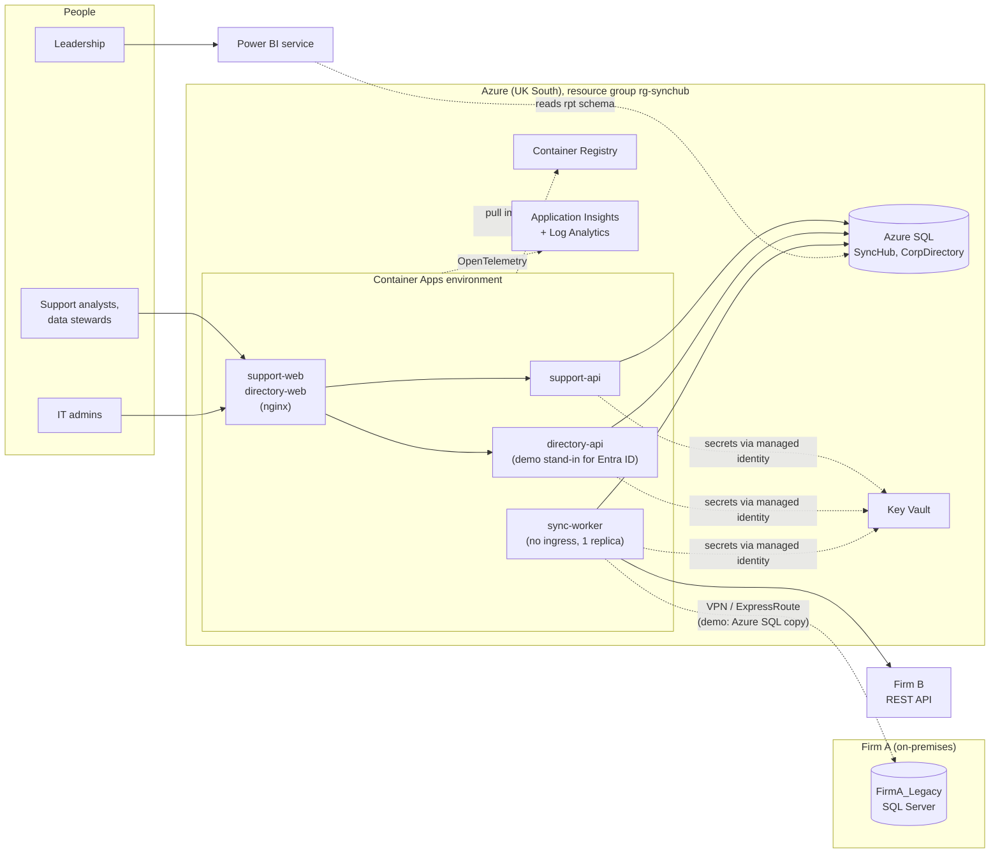

# Running Merger Sync Hub in Azure

How the system maps onto Microsoft Azure, the decisions behind it, and what would change between this
demo deployment and a production one at a law firm. The templates live in [`infra/`](../infra).

- [Architecture](#architecture)
- [Service by service](#service-by-service)
- [Identity and secrets](#identity-and-secrets)
- [Networking](#networking)
- [Monitoring and support](#monitoring-and-support)
- [Database changes for Azure SQL](#database-changes-for-azure-sql)
- [Deployment](#deployment)
- [Cost](#cost)
- [Demo vs production](#demo-vs-production)
- [Interview talking points](#interview-talking-points)

## Architecture

Everything that runs in Docker today becomes a **Container App**. The images don't change: only configuration does.

## Service by service

| Today (Docker) | In Azure | Why this choice |
|---|---|---|
| SQL Server 2022 container | **Azure SQL Database** (SyncHub, CorpDirectory) | Fully managed: backups, point-in-time restore, patching and high availability are included. The schema needs no changes (no cross-database queries, no SQL Agent jobs). |
| `FirmA_Legacy` | **Stays on-premises**, reached over a VPN or ExpressRoute; in the demo, a third Azure SQL database stands in for it | A legacy practice management database usually can't move. Hybrid connectivity is normal at law firms. |
| Support API, directory API, Firm B mock | **Container Apps** with HTTPS ingress, scale to zero | Same images; no servers to patch; pay only while handling requests |
| Sync worker | **Container App**, no ingress, exactly one replica | It runs a loop every minute and its watermark logic assumes one instance. Alternative: **Azure Functions** (timer trigger for the sync, queue trigger for replays), but long full loads favour a container. |
| React apps (nginx) | **Container Apps** (or Azure Static Web Apps, free tier) | Keeps one deployment model; Static Web Apps would be the cheaper production choice |
| Images on the local Docker host | **Azure Container Registry** | Container Apps pull with a managed identity: no registry password |
| `.env`, user secrets | **Key Vault** | Secrets are referenced by the Container Apps through managed identity |
| Prometheus, Loki, Grafana | **Application Insights + Log Analytics** | The services already speak OpenTelemetry; only the destination changes (see below) |
| Mock corporate directory | **Microsoft Entra ID** in production | The Support API already validates standard OIDC tokens, so moving means changing `Auth:Authority`. The demo keeps the mock so the demo accounts still work. |
| `core → rpt` load (stored procedure) | Unchanged (the worker calls it); at scale, **Azure Data Factory** or Microsoft Fabric | |
| GitHub Actions | **GitHub Actions** (or Azure DevOps Pipelines) with OIDC federation to Azure | No long-lived deployment secret in GitHub |

## Identity and secrets

- **Managed identities, not passwords.** Each Container App gets a user-assigned managed identity. It is granted:
  - `AcrPull` on the registry (to pull its image);
  - `Key Vault Secrets User` on the vault (to read its secrets);
  - a **contained database user** in Azure SQL (`CREATE USER [id-synchub-worker] FROM EXTERNAL PROVIDER`), with only the rights
    that service needs. Connection strings then use `Authentication=Active Directory Managed Identity`: no SQL password exists.
- **Azure SQL uses Entra authentication only** (SQL logins disabled). The demo's `sa` and `synchub_reporting` logins are
  replaced by Entra identities: the worker's and APIs' managed identities, and an Entra group for Power BI report authors.
- **Least privilege maps across directly:** the reporting role's `SELECT ON SCHEMA::rpt` grant becomes a grant to an Entra group.
- **People sign in with Entra ID** in production (MSAL in the React apps, Conditional Access and MFA from the firm's policies);
  [`infra/entra-setup.ps1`](../infra/entra-setup.ps1) creates the app registrations, roles and groups.
  App roles (`SyncHub.Support`, `SyncHub.DataSteward`...) are defined on the app registration and assigned to security
  groups, exactly as the mock directory models it.

## Networking

**Demo:** public HTTPS endpoints on the Container Apps; Azure SQL's firewall allows Azure services only. Simple and cheap.

**Production at a law firm** (confidential client data):
- Container Apps environment **inside a VNet** (internal), fronted by **Application Gateway or Front Door with WAF**.
- **Private endpoints** for Azure SQL, Key Vault and the registry; public network access disabled on all three.
- **Site-to-site VPN or ExpressRoute** to the office network for Firm A's on-premises database.
- Network security groups and DNS private zones; outbound traffic through the firm's firewall.

## Monitoring and support

- **The same OpenTelemetry instrumentation, a different exporter.** `AddObservability()` sends to the OTLP collector when
  `OpenTelemetry:OtlpEndpoint` is set (Prometheus and Loki locally) and to **Application Insights** when
  `APPLICATIONINSIGHTS_CONNECTION_STRING` is set (in Azure, via the Azure Monitor exporter). The services' code is identical.
- **Log Analytics (KQL)** replaces Loki for logs; the structured fields (`Source`, `CorrelationId`, `SyncRunId`) arrive as columns.
- **Azure Monitor alert rules** replace the Prometheus rules: no successful sync for 10 minutes, repeated failed runs,
  rejection rate, worker missing (heartbeat), stuck runs, reconciliation mismatches.
- **Azure Monitor workbooks or Azure Managed Grafana** replace the Grafana dashboard.
- Third-line support in Azure means: Application Insights failures and dependency views, KQL over the logs, Container Apps
  revision and replica logs, Azure SQL Query Performance Insight and automatic tuning, and Resource Health.

## Database changes for Azure SQL

The schema and procedures move as they are. Only the setup differs:

| Script line | In Azure SQL | How it's handled |
|---|---|---|
| `CREATE DATABASE`, `ALTER DATABASE ... SET RECOVERY` (01, 06) | Not allowed: Bicep creates the databases; recovery is always FULL with automatic backups | Skip 01 and these lines |
| `USE <database>` (02–07) | Not allowed: you connect to each database directly | Run each script connected to its own database |
| `CREATE LOGIN` (07) | Replaced by Entra users / groups | Separate Azure version of the grants |
| SIMPLE recovery, log shrinking, retention of backups | Managed by Azure (7–35 days point-in-time restore) | Nothing to do |

## Deployment

1. **Bicep** (`infra/main.bicep`) creates everything in one resource group: Log Analytics, Application Insights, Key Vault,
   Container Registry, Azure SQL server and databases, the Container Apps environment and apps, managed identities and role assignments.
2. **Images** are built with `az acr build` (the registry builds them; no local Docker push needed). The React images are
   built with the apps' Azure URLs as build arguments, because Vite bakes URLs in at build time.
3. **Database**: run the schema scripts against each database (skipping the `CREATE`/`ALTER DATABASE` and `USE` lines) and create
   the contained users for the managed identities, signed in as the Entra admin. See [`infra/README.md`](../infra/README.md).
4. **CI/CD** (next step): GitHub Actions signs in to Azure with OIDC federation (no secret stored), builds the images,
   runs `az deployment group create`, and runs the tests.

`az deployment group what-if` shows exactly what will change before anything is created.

## Cost

A small demo deployment, in UK South, torn down after the interview:

| Resource | Tier | Rough cost |
|---|---|---|
| Container Apps | Consumption; APIs and web apps scale to zero; worker 0.25 vCPU always on | Mostly within the monthly free grant; the worker is a few pounds a month |
| Azure SQL (×3) | Serverless with the free offer, or Basic | Free offer: no charge within its monthly allowance; Basic: a few pounds a month each |
| Container Registry | Basic | A few pounds a month |
| Log Analytics / App Insights | Pay-as-you-go | Pennies at this volume (first 5 GB a month free) |
| Key Vault | Standard | Pennies |

Expected total for a few days: **a few pounds at most**. An exact estimate from the Azure Retail Prices API is produced
before deploying, and a **budget alert** is created on the resource group. Deleting the resource group removes everything.

## Demo vs production

| Area | Demo | Production |
|---|---|---|
| Sign-in | Mock directory (demo accounts) | Entra ID, MSAL, MFA, Conditional Access |
| Network | Public HTTPS endpoints | VNet, private endpoints, WAF |
| Firm A | Azure SQL copy | On-premises over VPN / ExpressRoute |
| Database | Serverless / Basic, one region | General Purpose or Business Critical, zone-redundant, geo-replication / failover group |
| Web apps | Container Apps | Static Web Apps or Front Door + Storage |
| Monitoring | App Insights, a few alert rules | Action groups to the on-call rota, Service Health alerts |
| Governance | One resource group, tags | Landing zone, Azure Policy, budgets per subscription, Defender for Cloud |

## Interview talking points

- **Containerising first made the move to Azure mostly configuration:** the same images run in Docker and Container Apps.
- **Managed identity removes passwords entirely:** no connection-string secrets, no registry credentials, no shared reporting login.
- **Designed for Entra ID from the start:** the APIs validate standard OIDC tokens, so swapping the mock directory for Entra is a setting.
- **OpenTelemetry keeps monitoring vendor-neutral:** Grafana locally, Application Insights in Azure, with no code changes.
- **Hybrid is the realistic answer for legacy systems:** Firm A's database stays where it is and is reached privately.
- **Cost-aware by design:** scale to zero, serverless SQL, budget alerts, and one resource group to delete afterwards.
